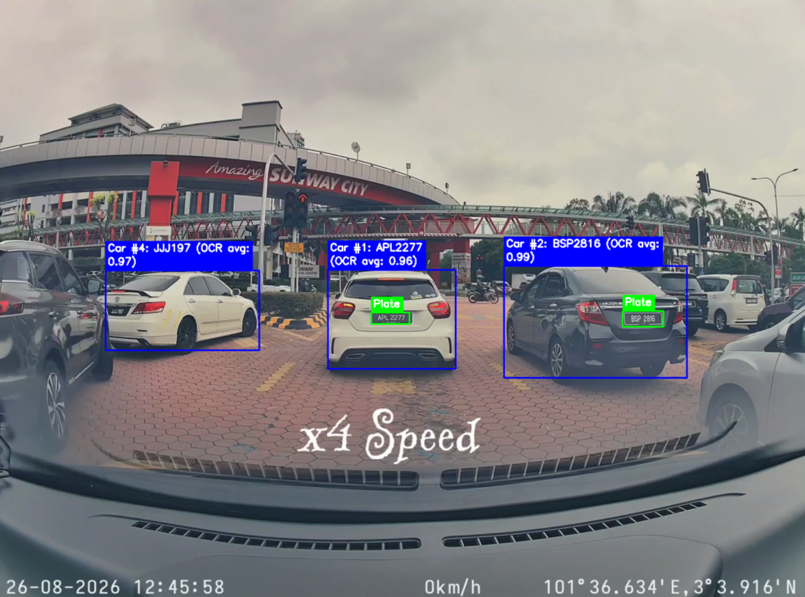

# Malaysia Car Plate Detection



## Training data source

The YOLO car and license plate detector (`models/yolo26n-v1.pt`) was trained using
the [Malaysian Car Plate Dataset, version 1](https://data.mendeley.com/datasets/9795rjwxnd/1)
by sw w, published on Mendeley Data on 24 February 2026.
DOI: `10.17632/9795rjwxnd.1`. Dataset license: CC BY 4.0.

Text recognition uses the pretrained PaddleOCR `PP-OCRv6_medium_rec` model.

## Run detection

Use Python 3.12 with Tkinter support. Create an environment and install dependencies
with `uv`:

```bash
uv venv --python 3.12 .venv
uv pip install --python .venv/bin/python -r requirements.txt
```

Sample files named `test*` are included in `dataset/test/`. Download the model
weights and sample videos with Git LFS:

```bash
git lfs pull
```

Model weights and sample MP4 videos use Git LFS. Add your own images or videos
to `dataset/test/`, then run:

```bash
.venv/bin/python inference.py
```

Add `--verbose` to print frame numbers, detection confidence, and OCR details.

Press Enter for the next file, or Space to pause/resume a video. Close the window to quit.
Videos play automatically
with detection capped at 10 FPS. Adjust settings in `car_plate_detector/config.py`.

Implementation details and contributor guidance are in [AGENTS.md](AGENTS.md).
